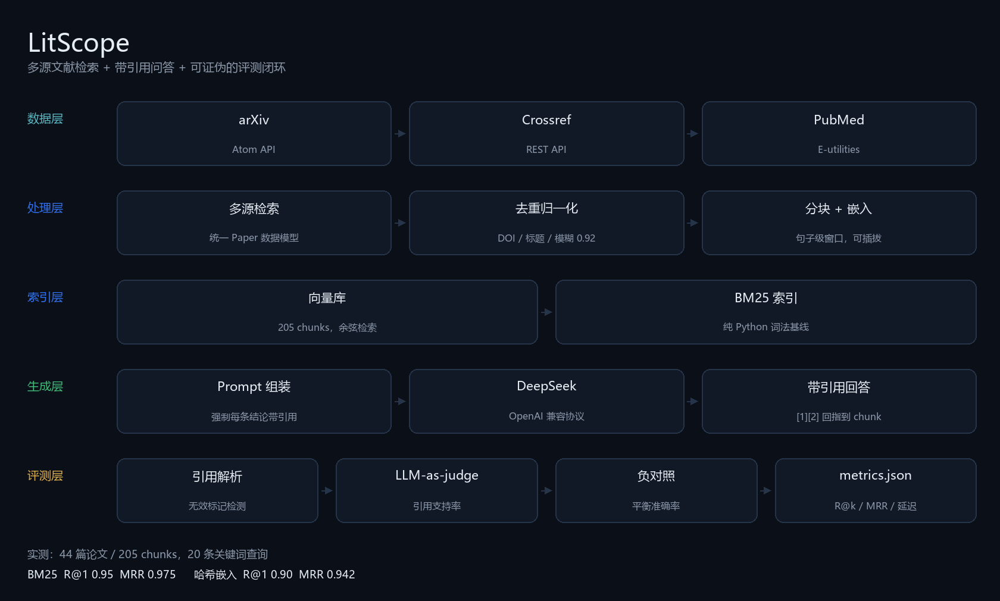
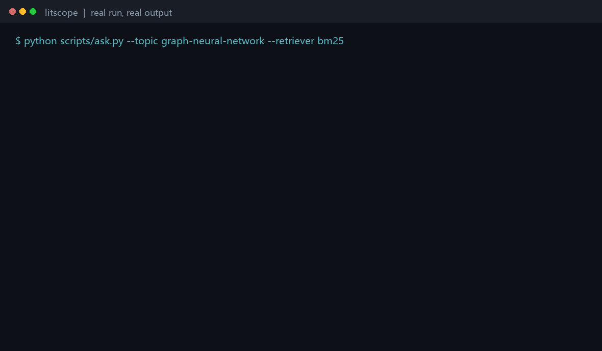

# LitScope

输入一个研究主题，得到一份每个结论都能回溯到原文的工作草稿。

## 解决什么问题

做综述时，检索、去重、归纳、标注出处是四件分离的手工活。LitScope 把它们串成一条可评测的流水线：多源检索 -> 去重归一化 -> 分块嵌入 -> 检索 -> 带引用生成 -> 引用审计。

## 快速上手

    pip install -r requirements.txt
    python scripts/check_env.py          # 检查 .env
    python scripts/ping_llm.py           # 验证 LLM 连通
    python scripts/serve.py              # 起服务

浏览器打开 http://127.0.0.1:8000。

上面这段是真实运行的输出回放（检索 + DeepSeek 生成），不是手画的示意图。素材由 scripts/gen_assets.py 生成。

## 量化结果

所有数字都可用仓库里的脚本复现，原始结果在 metrics*.json。

### 1. 检索阶段（多源召回 + 去重）

| 指标 | 值 |
| --- | --- |
| Recall@1 | 0.9167 |
| Recall@5 | 1.0000 |
| Recall@10 | 1.0000 |
| MRR | 0.9583 |
| 延迟 P50 / P95 | 7.06 s / 10.30 s |
| 评测条数 | 12（失败 0） |

### 2. 检索器对照：BM25 vs bge-m3（本项目最有信息量的一组数字）

同一语料（44 篇论文 / 205 chunks），两种查询模式。

#### A. 英文关键词查询（20 条）

| 检索器 | R@1 | R@3 | R@5 | R@10 | MRR | 延迟 P50 |
| --- | --- | --- | --- | --- | --- | --- |
| BM25（词法） | 0.95 | 1.00 | 1.00 | 1.00 | 0.975 | 0.5 ms |
| bge-m3（1024 维） | 0.95 | 0.95 | 1.00 | 1.00 | 0.960 | 196.5 ms |

BM25 略胜。词法查询本来就是它的主场。

#### B. 中文查询（15 条，论文标题译成中文）

| 检索器 | recall@5 | MRR | 返回空结果 | 延迟 P50 |
| --- | --- | --- | --- | --- |
| BM25（词法） | 0.1333 | 0.1333 | 13 / 15 | 0.1 ms |
| bge-m3（1024 维） | 1.0000 | 0.9333 | 0 / 15 | 198.6 ms |

中文查询下 BM25 有 15 条里的 13 条完全检不到东西，bge-m3 一条不落。

#### C. 结论：按场景选，不是二选一

| 场景 | 用什么 | 理由 |
| --- | --- | --- |
| 英文查询 | BM25（默认） | 效果持平，快约 400 倍，零成本、零外部依赖 |
| 中文查询 | dense（bge-m3） | BM25 不可用，只有多语言嵌入能跨语言 |

复现：

    python eval/compare_retrievers.py --topic graph-neural-network --papers 15 --questions 20 --query-mode keywords --top-k 10
    python eval/compare_retrievers.py --topic graph-neural-network --papers 15 --questions 15 --query-mode zh --top-k 5 --out metrics_compare_zh.json

### 3. RAG 端到端（6 个问题，top_k=5）

| 指标 | 值 |
| --- | --- |
| 目标论文检索率 | 1.0000 |
| 引用支持率（LLM 裁判） | 1.0000（12 对） |
| 无效引用标记数 | 0 |
| 延迟 P50 / P95 | 1.62 s / 1.99 s |
| token 总数 / 均值 | 3922 / 653.7 |

### 4. 裁判负对照

让同一个 claim 去配另一篇论文的段落，看裁判会不会照单全收：

| 指标 | 值 |
| --- | --- |
| 正例支持率（claim + 自己的来源） | 1.0000（6/6） |
| 负例拒绝率（claim + 别人的来源） | 1.0000（6/6） |
| 平衡准确率 | 1.0000 |

平衡准确率 0.5 意味着裁判是橡皮图章（永远说 SUPPORTED），1.0 意味着完美区分。所以第 3 节那个引用支持率不是白来的——裁判确实会拒绝。

## 踩过的一个真坑：跨语言静默失败

最初版本用我自己写的 256 维哈希嵌入，并用 BM25 做词法基线。跑中文提问时出现了这个：

    问题：图神经网络靠什么机制传播信息？
    检索返回 5 个段落，全部 score=0.0
    模型照常回答，引用写成 [1][2][3]

那 5 个段落其实是脉冲神经网络和音乐识别的论文——因为中文 token 与英文 token 零重叠，BM25 全部得分 0，排序退化成按文档顺序取前 5。系统没有任何报警，模型也没拒答。

两步修复：

1. app/index/bm25.py 加 min_score 过滤：零重叠返回空，而不是返回垃圾。补了 4 个测试守住，包括 test_pipeline_reports_empty_instead_of_garbage（并断言此时不调用 LLM）。
2. 接入多语言嵌入 bge-m3，中文查询 recall@5 从 0.13 变成 1.00。

这个坑的价值在于它不报错：没有异常、没有 500、日志干净，只是答案悄悄变错。评测脚本是唯一能发现它的东西——这也是先搭评测再调优的理由。

## 已知限制

- 只吃摘要与元数据，不解析全文 PDF
- 评测标签偏简单（标题译中文 / 关键词查询）；英文关键词模式下 Recall@5 已饱和，区分度主要来自 R@1 与 MRR
- 裁判与生成同源（deepseek-flash），负对照只做了部分缓解，不能完全排除自我偏好
- dense 检索每次查询要一次 embedding API 调用（约 200 ms），未做查询向量缓存
- 多源检索是串行 + 限速 sleep，未做并发与结果缓存

## 架构

五层，每层可独立测试：

    数据层  app/sources/    arXiv / Crossref / PubMed 适配器，统一 Paper
    处理层  app/dedupe.py   DOI -> 标题规范化 -> 模糊匹配 0.92
            app/index/      分块 + 嵌入（可插拔：哈希 / OpenAI 兼容）
    索引层  app/index/      向量库（纯 Python 余弦）与 BM25
    生成层  app/rag/        强制引用的 prompt -> DeepSeek -> 引用回指
    评测层  eval/           R@k / MRR / 引用支持率 / 裁判负对照

## Web 服务

    python scripts/serve.py

| 接口 | 说明 |
| --- | --- |
| GET / | 内置 Web UI |
| GET /api/health | 嵌入器、检索器、LLM 状态 |
| GET /api/search?q=&limit=&sources= | 多源检索 + 去重 |
| POST /api/ask | {topic, question, top_k, per_source, retriever} |

语料按 topic 缓存，同主题二次提问不重复检索。

## 配置

    LLM_PROVIDER=deepseek
    DEEPSEEK_API_KEY=...

跨语言检索需要多语言嵌入，填这三项后把 retriever 切到 dense：

    EMBEDDING_PROVIDER=openai
    EMBEDDING_BASE_URL=https://api.siliconflow.cn/v1
    EMBEDDING_API_KEY=...
    EMBEDDING_MODEL=BAAI/bge-m3

## 部署

见 docs/DEPLOY.md（Render / Railway 单服务部署，含上线自检清单）。

## 单元测试

    67 passed

全部离线可跑，不需要 API key（靠 ScriptedClient + 假数据源）。覆盖：三个源解析器、去重合并、分块、哈希嵌入、向量检索与持久化、BM25、零分词重叠过滤、引用解析、prompt 组装、RAG 流程、裁判判定、API 端点与语料缓存。

## 项目结构

    app/        核心代码（sources / index / rag / api / llm）
    eval/       评测脚本与指标
    scripts/    CLI 入口与资产生成
    tests/      单元测试
    docs/       设计文档、部署指南、图片素材
    metrics*.json  评测原始结果

## 状态

- W1 多源检索 + 去重归一化
- W2 索引层 + 评测骨架 + 检索指标
- W3 DeepSeek 客户端 + 带引用 RAG + 裁判负对照
- W4 FastAPI + 内置 Web UI + 部署配置 + README 素材
- W5 BM25 基线 + 跨语言静默失败修复 + bge-m3 对照评测

下一步：线上部署。
